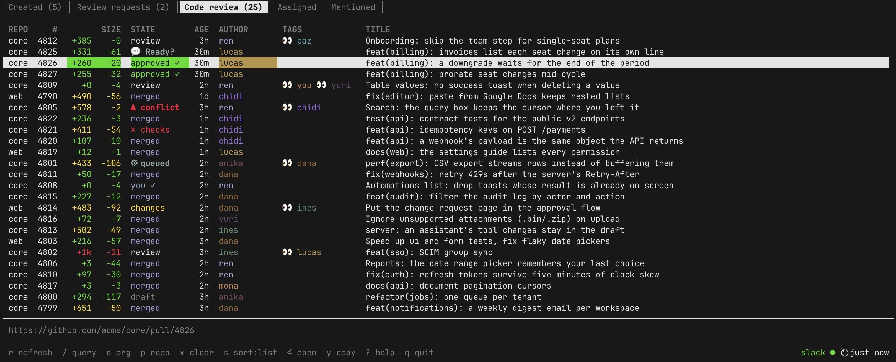

# anton

The pull requests you need to look at, in your terminal, with what Slack knows about them.



anton lists the GitHub PRs that concern you: what you opened, what you were
asked to review, what your team posted in `#code-review`. Each row shows the
size of the change, where it stands (approved, conflicting, failing checks,
queued for deploy, merged), how long it's been open, and who is reviewing it.
`⏎` opens it in the browser. anton doesn't show diffs and doesn't write
to GitHub.

Named after the critic in *Ratatouille*.

## Install

Prebuilt for macOS (Apple silicon) and Linux (x86_64):

```sh
curl --proto '=https' --tlsv1.2 -sSf \
  https://raw.githubusercontent.com/Thinato/anton/main/install.sh | sh
```

It puts `anton` and `anton-slkx` in `~/.local/bin` (override with
`ANTON_INSTALL_DIR`) and fetches the latest release (pin one with
`ANTON_VERSION=v0.1.0-beta`). anton needs [`gh`](https://cli.github.com),
logged in; the Slack plugin also needs [slkx](https://github.com/Thinato/slkx).

To build from source you need CMake 3.20+ and a C++20 compiler:

```sh
git clone https://github.com/Thinato/anton && cd anton
cmake -B build && cmake --build build
./build/anton
```

Dependencies (FTXUI, nlohmann/json) are fetched by CMake. `cmake --install
build` puts `anton` and `anton-slkx` in your prefix.

## Use

anton opens on GitHub's own pull-request tabs: Created, Review requests,
Assigned, Mentioned. Every tab is a GitHub search, so anything the search box
takes works here.

| key | |
| --- | --- |
| `j` `k` `g` `G` | move |
| `⏎` / `y` | open in browser / copy URL |
| `/` | edit the query: `is:open review-requested:@me label:bug` |
| `o` `p` `x` | scope to an org / a repo / clear it |
| `s` | sort: updated, created, size, repo |
| `1`–`9` `Tab` | switch tab |
| `r` | refresh (also automatic, every 2 min) |
| `?` | help, including keys plugins add |

`anton --query 'repo:me/thing is:open'` opens a single ad-hoc tab.

SIZE is `+additions -deletions` in short form (`+12k -40`): green when small,
red when it'll eat your afternoon. STATE shows the one thing that matters most,
in this order: merged, conflict, a plugin's status, draft, failing checks,
changes requested, approved, your own review, waiting for review.

## Configure

`~/.config/anton/config.json`. Every key is optional.

```json
{
  "views": [
    { "name": "Code review", "plugin": "slack", "list": "code-review", "query": "recent:24h" },
    { "name": "Mine",        "query": "is:open author:@me" }
  ],
  "size": { "green_below": 450, "red_from": 1000 },
  "title_strip": "^\\[[A-Z]+-\\d+\\]\\s*",
  "people": {
    "octocat": { "name": "mona", "hex": "#a2a5d8", "ansi": 146 }
  },
  "plugins": [
    { "name": "slack",
      "command": ["anton-slkx", "--review-channel", "#code-review",
                                "--deploy-channel", "#deploy"],
      "rerun": "exit" }
  ]
}
```

- `views` replaces the default tabs. The first is where anton opens.
- `title_strip` cuts a regex out of every title, e.g. the ticket ID your team
  prefixes PRs with.
- `people` renames GitHub logins and colors them. Use the same name your Slack
  shows and the 👀 tags line up with the author column. `hex` is used on
  truecolor terminals and `ansi` (a name or 0–255) on everything else.
- `recent:24h` is anton's own filter: open PRs, plus those closed or merged in
  the last 24 hours. It's handy on a Slack tab, where merges are worth seeing.

## Plugins

A plugin is any program that prints JSON lines. This is a whole plugin:

```sh
#!/bin/sh
echo '{"pr": "https://github.com/me/thing/pull/42", "tags": [{"glyph": "🔥", "text": "hotfix"}]}'
```

```json
{ "name": "hot", "command": ["./hot.sh"], "rerun": "refresh" }
```

A plugin can put PRs on a list (which a tab can show), set a custom STATE,
add tags, and register keys. Long-running plugins also get a stdin, where
anton sends the keys you pressed and your approvals. The protocol is in
[specs/02-plugins.md](specs/02-plugins.md).

### Slack

`anton-slkx` is built with anton. It reads Slack through
[slkx](https://github.com/Thinato/slkx), which needs to be on your `PATH` and
logged in.

- Every PR posted to `--review-channel` shows up on a `code-review` list,
  newest post first, the same order as the channel.
- `:eyes:` reactions become `👀 name` tags.
- `v` marks you as reviewing (adds your `:eyes:`). When you approve on GitHub,
  anton swaps it for `:+1:`.
- With `--deploy-channel`, a posted PR reads `⚙ queued` until it merges.
  `💬 Ready?` means the deploy bot is waiting on you.

It follows the channel live over Slack's websocket, so a new post shows up in
about a second. Flags and details are in
[specs/03-plugin-slkx.md](specs/03-plugin-slkx.md).

## Develop

```sh
cmake --build build && ctest --test-dir build
```

The specs in [specs/](specs/) describe what anton does and why. Change the
spec when you change the behavior. The logic that matters (state ranking,
filters, the Slack event fold) is kept in pure headers, `src/model.hpp` and
`plugins/slkx/fold.hpp`, checked by the asserts in `tests/`.

Work goes through pull requests. CI builds and runs the checks on each one,
and they must pass to merge. Every merged PR publishes the next release,
`v<major.minor>.N-beta`, with macOS and Linux binaries; bump `VERSION` in
`CMakeLists.txt` to start a new major.minor.

`docs/demo/run.sh` runs anton on made-up PRs with a fake `gh` and a fake Slack
plugin. The screenshot comes from it.
