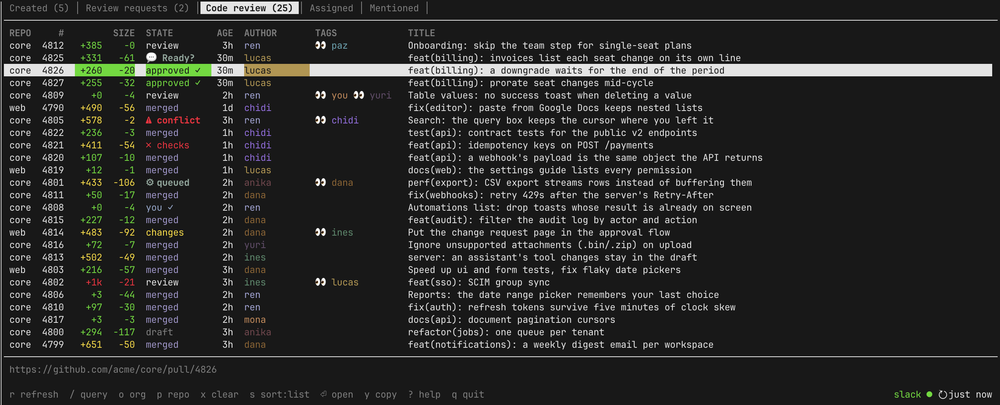
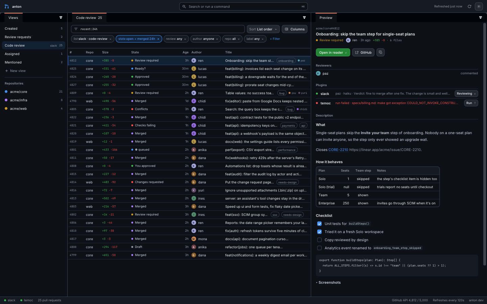
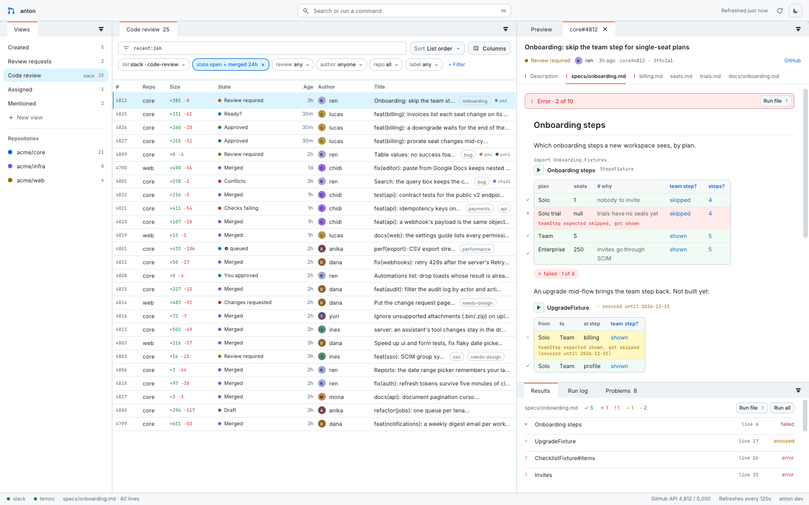

# anton

The pull requests you need to look at, in your terminal, with what Slack knows about them.



anton lists the GitHub PRs that concern you: what you opened, what you were
asked to review, what your team posted in `#code-review`. Each row shows the
size of the change, where it stands (approved, conflicting, failing checks,
queued for deploy, merged), how long it's been open, and who is reviewing it.
`⏎` reads its description and the markdown files it changes, rendered the
way [glow](https://github.com/charmbracelet/glow) does, and `w` opens it in
the browser. anton doesn't show diffs and doesn't write to GitHub.

Named after the critic in *Ratatouille*.

## Install

Prebuilt for macOS (Apple silicon) and Linux (x86_64):

```sh
curl --proto '=https' --tlsv1.2 -sSf \
  https://raw.githubusercontent.com/Thinato/anton/main/install.sh | sh
```

It puts `anton`, the desktop app `anton-gui` and the plugins (`anton-slkx`, `anton-llm`, `anton-temoc`) in `~/.local/bin` (override
with `ANTON_INSTALL_DIR`) and fetches the latest release (pin one with
`ANTON_VERSION=v0.1.0-beta`). After that, anton updates itself: when a release
is out it swaps in the new binaries and asks you to restart
(`"auto_update": false` in the config to only be told). anton needs [`gh`](https://cli.github.com),
logged in; the Slack plugin also needs [slkx](https://github.com/Thinato/slkx).

To build from source you need CMake 3.20+ and a C++20 compiler:

```sh
git clone https://github.com/Thinato/anton && cd anton
cmake -B build && cmake --build build
./build/anton
```

Dependencies (FTXUI, nlohmann/json, md4c; Dear ImGui, GLFW and
stb_image_write for `anton-gui`) are fetched by CMake. On Linux `anton-gui`
needs the X11 headers (`sudo apt install xorg-dev libgl-dev`); without them,
or to skip it, configure with `-DANTON_GUI=OFF`. `cmake --install build` puts
`anton`, `anton-gui` and the plugins in your prefix.

## Use

anton opens on GitHub's own pull-request tabs: Created, Review requests,
Assigned, Mentioned. Every tab is a GitHub search, so anything the search box
takes works here.

Under the tabs, the tab's filter is always on screen twice: as chips
(`state open ✕`, `review any ▾`, `label bug ✕`) and as the query they make
(`/ is:open author:@me label:bug`). Click a chip for its options, its `✕` to
drop it, `+ filter` to add a label, author, reviewer and more, or edit the
query with completion (`Tab`). Change a tab's filter and it gets a yellow `•`
with `Save`, `Save as new view` and `Revert`; Save writes it to your config.

Everything takes the mouse: tabs (right-click for rename, duplicate, move,
delete), chips, column headers (click to sort), rows (double-click reads),
buttons, the wheel. Every button shows its key, and `?` lists every command.

| key | |
| --- | --- |
| `j` `k` `g` `G` | move |
| `⏎` | read the description (`j` `k` `space` `g` `G` scroll, `Tab` `[` `]` the PR's `.md` files, `q` back) |
| `w` / `y` | open in browser / copy URL |
| `/` `f` | edit the query: `is:open review-requested:@me label:bug` / add a filter |
| `o` `p` `x` | scope to an org / a repo / clear it |
| `s` | sort: updated, created, size, repo |
| `1`–`9` `Tab` | switch tab |
| `S` `m` `+` | save the tab's filter / the tab's menu / a new tab |
| `r` | refresh (also automatic, every 2 min) |
| `n` | read a plugin's note on the PR, like an LLM review |
| `,` / `e` | settings / config.json in `$EDITOR` |
| `?` | every command, including keys plugins add |

`anton --query 'repo:me/thing is:open'` opens a single ad-hoc tab.

On a wide terminal the reader has an outline on the right: headings, or on
a temoc spec the file's result, each table's, what did not pass, and the
command that ran.

SIZE is `+additions -deletions` in short form (`+12k -40`): green when small,
red when it'll eat your afternoon. STATE shows the one thing that matters most,
in this order: merged, conflict, a plugin's status, draft, failing checks,
changes requested, approved, your own review, waiting for review.

## Configure

`~/.config/anton/config.json`. Every key is optional. Settings (`,`) change
tabs, columns, size colors, the title strip, refresh, updates and the mouse,
and write them to this file as you go, leaving the rest of it (plugins,
people, your own keys) as it was; `e` opens it in `$EDITOR` for the rest.

```json
{
  "views": [
    { "name": "Code review", "plugin": "slack", "list": "code-review", "query": "recent:24h" },
    { "name": "My turn",     "plugin": "slack", "list": "review-turn",
      "query": "is:open -is:draft review:required", "notify": true },
    { "name": "Mine",        "query": "is:open author:@me" }
  ],
  "size": { "green_below": 450, "red_from": 1000 },
  "title_strip": "^\\[[A-Z]+-\\d+\\]\\s*",
  "people": {
    "octocat": { "name": "mona", "hex": "#a2a5d8", "ansi": 146 }
  },
  "plugins": [
    { "name": "slack",
      "command": ["anton-slkx", "--review-channel", "#code-review",
                                "--deploy-channel", "#deploy"],
      "rerun": "exit" }
  ]
}
```

- `views` replaces the default tabs. The first is where anton opens
  (`"start_view": "Mine"` picks another). A view's `"sort"` is where its sort
  starts. `"notify": true` on a list view sends a desktop notification
  when a PR newly shows in it, once a session.
- `title_strip` cuts a regex out of every title, e.g. the ticket ID your team
  prefixes PRs with.
- `people` renames GitHub logins and colors them. Use the same name your Slack
  shows and the 👀 tags line up with the author column. `hex` is used on
  truecolor terminals and `ansi` (a name or 0–255) on everything else.
- `columns` picks the columns and their order: any of `repo`, `number`,
  `size`, `state`, `age`, `author`, `tags`, `title`. An object instead of a name
  is a column you fill yourself. Its command gets the PR as JSON on stdin and
  as `{url}`, `{repo}`, `{number}`, `{title}`… in its arguments, and the first
  line it prints is the cell:

  ```json
  "columns": ["repo", "size", "state", "age", "author",
              { "name": "BASE", "width": 10,
                "command": ["gh", "pr", "view", "{url}", "--json", "baseRefName", "-q", ".baseRefName"] },
              "tags", "title"]
  ```

  It reruns on each refresh and when the PR changes. Details are in
  [specs/01-anton.md](specs/01-anton.md#command-columns).
- `recent:24h` is anton's own filter: open PRs, plus those closed or merged in
  the last 24 hours. It's handy on a Slack tab, where merges are worth seeing.
  A Slack tab filters locally, so it takes `is:`, `org:`, `repo:`, `author:`,
  `review:`, `label:`, `reviewed-by:@me` and `recent:`.
- `"mouse": false` leaves the mouse to your terminal.

## Plugins

A plugin is any program that prints JSON lines. This is a whole plugin:

```sh
#!/bin/sh
echo '{"pr": "https://github.com/me/thing/pull/42", "tags": [{"glyph": "🔥", "text": "hotfix"}]}'
```

```json
{ "name": "hot", "command": ["./hot.sh"], "rerun": "refresh" }
```

A plugin can put PRs on a list (which a tab can show), set a custom STATE,
add tags, attach a note you read with `n`, and register keys. Long-running plugins also get a stdin, where
anton sends the keys you pressed and your approvals. The protocol is in
[specs/02-plugins.md](specs/02-plugins.md).

### Slack

`anton-slkx` is built with anton. It reads Slack through
[slkx](https://github.com/Thinato/slkx), which needs to be on your `PATH` and
logged in.

- Every PR posted to `--review-channel` shows up on a `code-review` list,
  newest post first, the same order as the channel.
- `:eyes:` reactions become `👀 name` tags.
- The PRs that are yours to review next are also on a `review-turn` list:
  those posted by the person just above your newest post (their posts up to
  the next person), that nobody else has `:eyes:` on.
- `v` marks you as reviewing (adds your `:eyes:`). When you approve on GitHub,
  anton swaps it for `:+1:`.
- With `--deploy-channel`, a posted PR reads `⚙ queued` until it merges.
  `💬 Ready?` means the deploy bot is waiting on you.

It follows the channel live over Slack's websocket, so a new post shows up in
about a second. Flags and details are in
[specs/03-plugin-slkx.md](specs/03-plugin-slkx.md).

### LLM reviews

`anton-llm` is built with anton too. It runs your own agent on a PR and puts
what it prints in the PR's note. It doesn't know any model: you give it
commands, one per key, in `~/.config/anton/llm.json`.

```json
{
  "reviewers": [
    {
      "key": "R", "tag": "haiku", "stdin": "diff", "checkout": "as-is",
      "prompt": "Review the diff on stdin for {repo}#{number}. Only flag real bugs. Be terse.",
      "command": [
        "claude", "-p", "--model", "haiku", "--tools", "", "--setting-sources", "",
        "--no-session-persistence", "{prompt}"
      ]
    },
    {
      "key": "S", "tag": "deepseek", "stdin": "diff",
      "system": "You review pull requests. Be terse.",
      "prompt": "Review this diff of {repo}#{number}.",
      "command": ["llm", "-m", "deepseek-chat", "-s", "{system}", "{prompt}"]
    }
  ]
}
```

```json
{ "name": "llm", "command": ["anton-llm"] }
```

Press `R` on a PR and its tags show `🤖 haiku…` while it runs, then
`🤖 haiku`; `n` reads the review. `{name}` in a command is replaced by the
reviewer's field of that name, or by `{pr_url}` (also `$PR_URL`), `{repo}`,
`{number}`, `{note}` (the last review, so another key can post it), `{tmp}`
(a temp directory for this run) and `{repo_dir}`. `"stdin": "diff"` pipes in
`gh pr diff`. A run that fails or passes its `timeout` (600s) shows
`🤖 haiku failed` and the error in the note.

With `"repos": {"owner/name": "~/path/to/clone"}`, a PR of that repo is
reviewed in a temporary `git worktree` of its head (`"checkout": "pr"`, the
default), or in your clone as it is (`"as-is"`). The worktree is detached
and removed afterwards; your clone's branch and files aren't touched.

An agent can post its review on GitHub itself. Here Haiku reads the PR's
code, writes a review with inline comments and `suggestion` blocks, and
posts it as a comment-only review:

```json
{
  "repos": {"acme/core": "~/src/core"},
  "reviewers": [
    {
      "key": "H", "tag": "haiku", "label": "Haiku reviews on GitHub", "timeout": 900,
      "prompt": "Review {pr_url} and post your review on it.",
      "system": "You review a GitHub pull request and post the review on GitHub yourself.\n\nThe current directory is a checkout of the PR's head: read code there with Read, Grep and Glob. The only commands you can run are `gh pr view {pr_url} ...`, `gh pr diff {pr_url} ...`, `gh api repos/{repo}/pulls/{number}/files` and the post command below. Anything else is refused, so don't look for other ways.\n\n1. Get the diff (`gh pr diff {pr_url}`) and the head commit (`gh pr view {pr_url} --json headRefOid`).\n2. Read the code around the changes where you need context. Only flag real problems: bugs, security holes, missed edge cases, docs that say the wrong thing. No praise, no style nits.\n3. Write the review to {tmp}/review.json:\n   {\"commit_id\": \"<headRefOid>\", \"event\": \"COMMENT\", \"body\": \"<summary>\", \"comments\": [{\"path\": \"src/a.cpp\", \"line\": 42, \"side\": \"RIGHT\", \"body\": \"...\"}]}\n   - \"event\" is always \"COMMENT\". Never approve or request changes.\n   - \"line\" is a line of the new file inside a hunk of the diff; any other line makes GitHub reject the whole review. For several lines add \"start_line\" (same hunk) and \"start_side\": \"RIGHT\".\n   - When you have a concrete fix, end the comment with a ```suggestion block holding the exact new text of those lines, indented as in the file. Otherwise just say what is wrong.\n   - \"body\" is a summary of two or three sentences. If nothing is wrong, post no comments and say so.\n4. Post it with exactly this command: gh api --method POST repos/{repo}/pulls/{number}/reviews --input {tmp}/review.json\n   If GitHub answers 422, fix review.json and post again.\n5. End with a short markdown summary of what you posted: the review's html_url from the response, then one line per comment (path:line and the gist).",
      "settings": {
        "permissions": {
          "allow": [
            "Bash(gh pr view {pr_url} *)",
            "Bash(gh pr diff {pr_url} *)",
            "Bash(gh api repos/{repo}/pulls/{number}/files)",
            "Bash(gh api --method POST repos/{repo}/pulls/{number}/reviews --input {tmp}/review.json)",
            "Edit(/{tmp}/review.json)"
          ],
          "deny": [
            "Bash(gh pr comment *--body-file*)", "Bash(gh pr comment *-F*)",
            "Bash(gh pr comment *--edit-last*)", "Bash(gh pr comment *--delete-last*)",
            "Bash(gh api graphql *)", "Bash(gh extension *)", "Bash(gh alias *)",
            "Bash(npx *)", "Bash(docker *)"
          ],
          "blockReadsOutsideWorkingDirectories": true
        },
        "hooks": {"PreToolUse": [{"matcher": "Bash", "hooks": [
          {"type": "command", "command": "anton-llm", "args": ["--check-review"], "onFailure": "block"}
        ]}]}
      },
      "command": ["claude", "-p", "--model", "haiku",
                  "--setting-sources", "", "--settings", "{settings}", "--add-dir", "{tmp}",
                  "--strict-mcp-config", "--tools", "Read,Grep,Glob,Bash,Write", "--permission-mode", "dontAsk",
                  "--max-turns", "40", "--max-budget-usd", "1", "--no-session-persistence",
                  "--append-system-prompt", "{system}", "{prompt}"]
    }
  ]
}
```

It can't approve, request changes, merge, push or edit your files: its only
tools are the ones named, `dontAsk` denies anything not allowed, the allow
rules are exact commands for this PR, `--setting-sources ""` keeps the
PR's own `.claude/` settings (and yours) out, and `anton-llm
--check-review`, a hook, refuses any review whose `event` isn't
`"COMMENT"`. To let it approve PRs it finds nothing wrong with, give the
hook `"args": ["--check-review", "--allow-approve"]` and tell it so in
`system`; the approval is yours as far as GitHub is concerned. A
draft-then-post pair, where you read the draft before a second key posts
it, and the details are in [specs/04-plugin-llm.md](specs/04-plugin-llm.md).

### Acceptance specs

`anton-temoc` runs the [temoc](https://github.com/killertux/temoc) specs a
PR changes. Tell it where your clones are and which temoc config starts
their fixture server, in `~/.config/anton/temoc.json`:

```json
{ "repos": { "acme/core": { "dir": "~/src/core", "config": "Config.toml" } } }
```

```json
{ "name": "temoc", "command": ["anton-temoc"] }
```

A fresh worktree has no `node_modules` or built packages; if the fixture
server needs them, give the repo a `setup` command, run in the checkout
before temoc:

```json
"setup": ["sh", "-c", "pnpm install --frozen-lockfile --ignore-scripts && pnpm --filter @acme/utils build"]
```

Press `T` on a PR: it checks out the PR's head in a temporary worktree,
runs `temoc --output jsonl` on the changed `.md` files that have a
`decisionTable` table, and tags the row `🧪 temoc…`, then `🧪 14 ✓` or
`🧪 2 ✗ 12 ✓` (`💤 4` for snoozed rows). `n` lists each failing row as
`file:line` with what was expected and what came back.

`⏎` then `Tab` opens the spec itself, with its results laid out the way
[temoc-ui](https://github.com/killertux/temoc-ui) does: each row tinted
and marked (`✓` passed, `✗` failed, `!` error, `~` snoozed, `-` skipped,
`⋯` running), what didn't pass under it, and each table's result:

```
 Description │ 🧪 failing.md ✓ 2 ✗ 1 │
──────────────────────────────────────────
     ## Multiplication
  ✗  🧪 Calculator
     ┌───┬───┬───────────────────────┐
  ▶  │ a │ b │ mul?                  │
     ├───┼───┼───────────────────────┤
  ✓  │ 2 │ 3 │ 6                     │
  ✗  │ 2 │ 2 │ 5                     │
     │   mul expected 5, got 4       │
     ├───┴───┴───────────────────────┤
     │ ✗ failed · 1 of 2             │
     └───────────────────────────────┘
```

Rows fill in as temoc runs them. The `▶` on a table's header (or on a row,
under the mouse) runs just that table or row; `J`/`K` pick a table and `r`
runs it, `T` runs the file. Any `.md` the PR changes gets a tab, specs
first. temoc's hidden directives show as `🧪 Fixture` badges (with
`· snoozed until …`), and a test's expected-value columns (`sum?`) stand
out from its inputs.

This runs the PR's code on your machine, like running its tests yourself:
the fixtures and, with a `config` inside the repo, the server command the PR
names. It only runs when you press the key. Details in
[specs/05-plugin-temoc.md](specs/05-plugin-temoc.md).

## Desktop app

`anton-gui` is the same anton in a window, in GitHub's light and dark
colors: the views on the left, the PR list with its filter chips, and a
preview with what each plugin says and its buttons (`Run`). It reads
the same `config.json` and runs the same plugins. On macOS its menus are
in the system's menu bar.



`Enter` opens a PR in the reader, a tab beside the preview: its
description and markdown files rendered like GitHub, a spec's temoc
results on its rows (tinted, marked, what failed under the row, each
table's result, a `▶` to run a table), and under it the file's results,
a run log streaming the plugin's progress, and the problems.



Every pane docks: drag a tab to move it, a line to resize, out of the
window to float it in a window of its own; the layout is kept in
`~/.config/anton/gui-layout.ini` and View › Reset Layout puts it back.
`Cmd K` (`Ctrl K`) is a command palette, `Cmd ,` the settings (theme,
the list's columns, author and state styles, row height, text sizes,
where the reader opens, views, plugins), saved to `config.json` as you
go. The TUI's keys work too. Details, the `gui` config keys and
`--screenshot` are in [specs/06-gui.md](specs/06-gui.md).

## Develop

```sh
cmake --build build && ctest --test-dir build
```

The specs in [specs/](specs/) describe what anton does and why. Change the
spec when you change the behavior. The logic that matters (state ranking,
filters, the Slack event fold, the LLM config, the markdown renderer, the
temoc event fold, anton-gui's theme and run log) is kept pure, in `src/model.hpp`,
`plugins/slkx/fold.hpp`, `plugins/llm/llm.hpp`, `src/markdown.cpp`,
`plugins/temoc/temoc.hpp` and `src/gui_logic.hpp`,
checked by the asserts in `tests/`.

Work goes through pull requests. CI builds and runs the checks on each one,
and they must pass to merge. Every merged PR publishes the next release,
`v<major.minor>.N-beta`, with macOS and Linux binaries; bump `VERSION` in
`CMakeLists.txt` to start a new major.minor.

`docs/demo/run.sh` runs anton (`ANTON=build/anton-gui` for the desktop app)
on made-up PRs with a fake `gh`, a fake Slack plugin and a fake temoc (`⏎` then `Tab` on the top PR of Code review; its
`billing.md` tab shows a run that failed outside its rows, `trials.md` one
not run yet, and `T`, `r` or a `▶` click replays a run phase by phase and
row by row). `DEMO_TEMOC=badconfig` or `DEMO_TEMOC=crash` before it shows a
broken temoc.json or a plugin that won't start.
The screenshots come from it; the desktop app's (`docs/gui/`) from
`ANTON=build/anton-gui ./docs/demo/run.sh --screenshot docs/gui/list-dark.png --screen list --theme dark --pr 4812`
(`--screen reader|settings|palette`, `--theme light`, `--file specs/onboarding.md` for the reader,
`--settings-page list`, `--palette-query temoc`).
